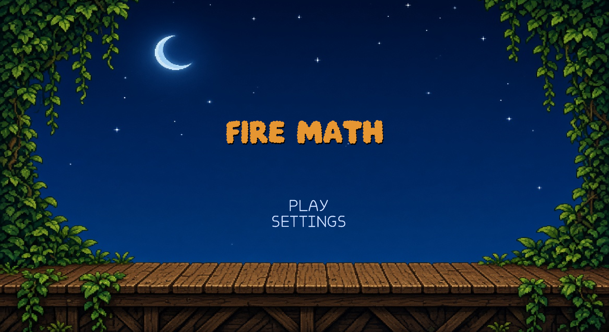
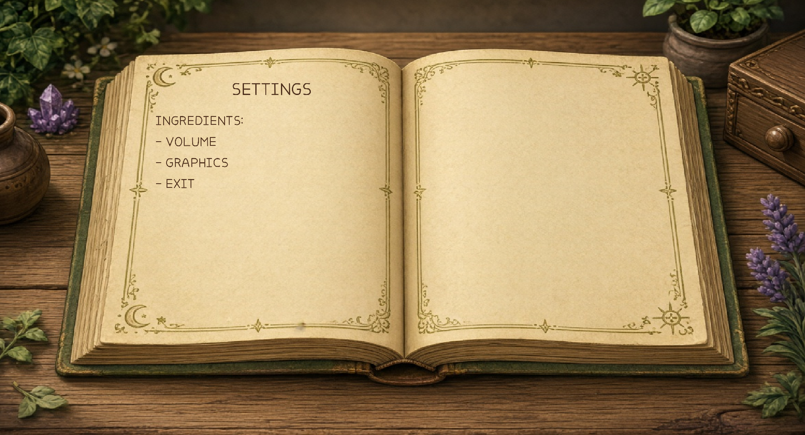
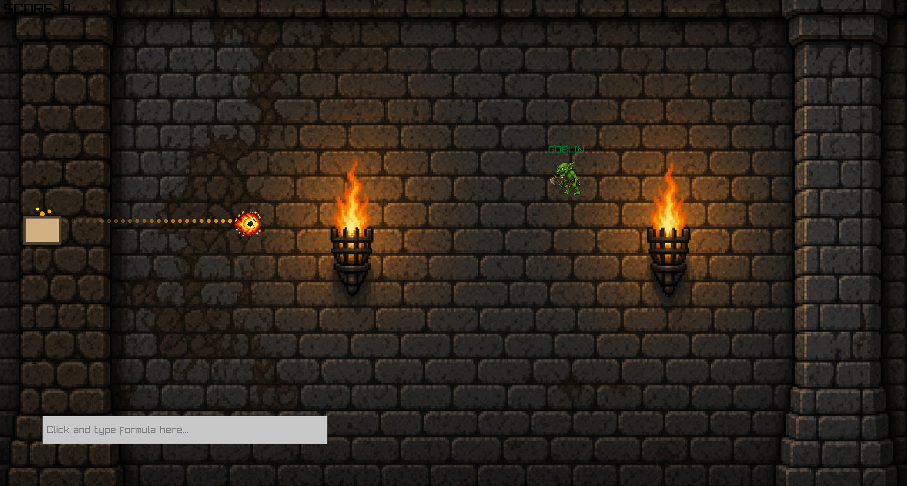

Fire Math

**Студент:** Сопот Артемий Дмитриевич
**Группа:** АСУб-26-2

## 1. Актуальность и идея проекта
Многие школьники и студенты испытывают трудности с изучением графиков функций (парабол, гипербол, синусоид) и не видят их практического применения. 
**Fire Math** — это 2D-игра с механикой, похожей на *Angry Birds*. Игроку необходимо попасть огненным снарядом в гоблина, вводя не просто числа,
а **математические функции** (например, `y = 0.5 * x` или `y = sin(x)`).
Это позволяет в игровой форме изучать поведение графиков и развивает математическое мышление.

## 2. Цель и задачи
**Цель:** Разработать интерактивную игру-песочницу на языке C++ с использованием библиотеки raylib, где траектория выстрела задается математической формулой.
**Задачи:**
1. Освоить работу с графической библиотекой raylib.
2. Реализовать систему ввода текста (парсинг формул).
3. Подключить математическую библиотеку (muparser) для вычисления пользовательских формул.
4. Реализовать физику полета снаряда и систему коллизий (попадание в цель/препятствия).
5. Создать пользовательский интерфейс (меню, экран настроек в виде книги, экран диалога с персонажем).

## 3. Используемые технологии
*   **Язык программирования:** C++
*   **Среда разработки:** Visual Studio 2026 (Community)
*   **Графическая библиотека:** raylib (v6.2)
*   **Сторонние библиотеки:** muparser (для парсинга математических выражений)
*   **Система контроля версий:** Git / GitHub

## 4. Описание текущей реализации (Функционал)
На данный момент реализованы следующие элементы:
*   **Главное меню:** С анимированным ночным фоном, кастомными шрифтами и кнопками (Play, Settings).
*   **Экран настроек:** Выполнен в виде разворота магической книги с интерактивными элементами (при наведении текст меняет цвет).
*   **Экран диалога:** С магом, который объясняет механику игры.
*   **Игровая песочница (Core Gameplay):** 
    *   Реализовано поле ввода, принимающее математические формулы.
    *   Подключен парсер, который переводит текст (например, `2*x`) в координаты.
    *   Шарик летит по траектории, заданной формулой игрока.
    *   Реализован гоблин (спрайт), проверка попадания в него (коллизии) и начисление очков.

## 5. Структура управления
*   **Ввод формулы:** клик по полю ввода, набор текста, `Enter` (выстрел).
*   **Управление в игре:** `R` — респавн гоблина (перезапуск), `Escape` — выход в меню.

## 6. Планы по доработке
1. Добавление статических препятствий (каменные стены, потолки), которые заставят игрока подбирать более сложные формулы для облета.
2. Создание системы уровней с нарастающей сложностью.
3. Добавление звукового сопровождения (музыка, звук выстрела).

## 7. Скриншоты

